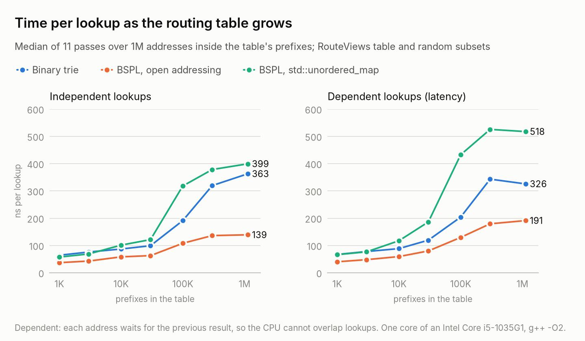
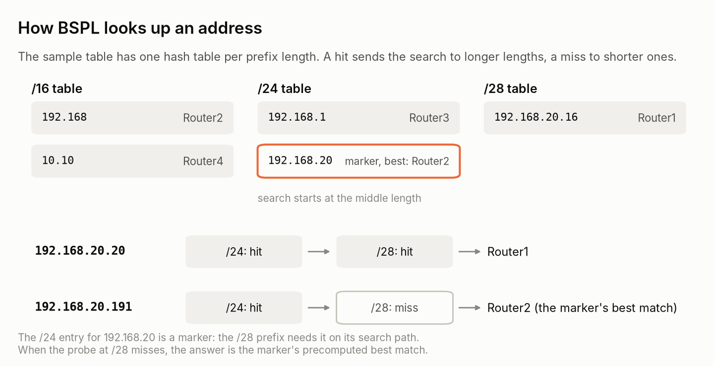
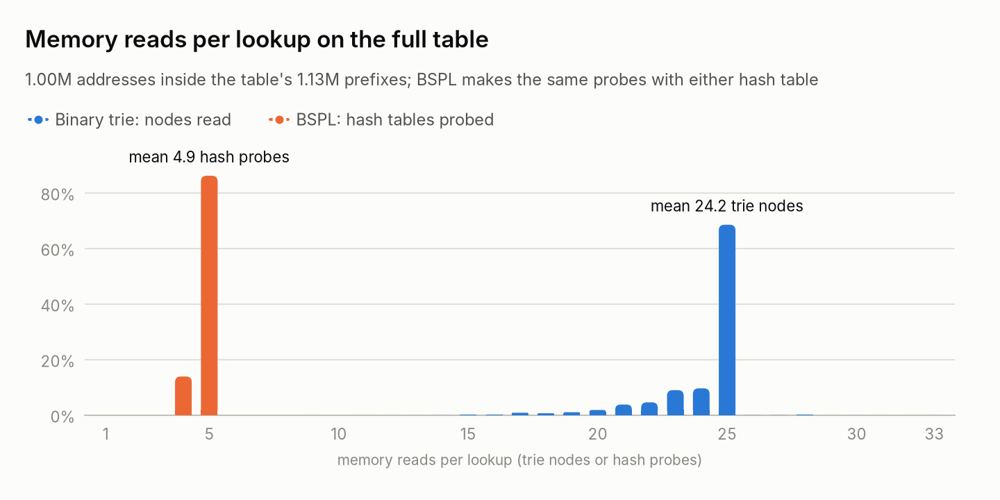
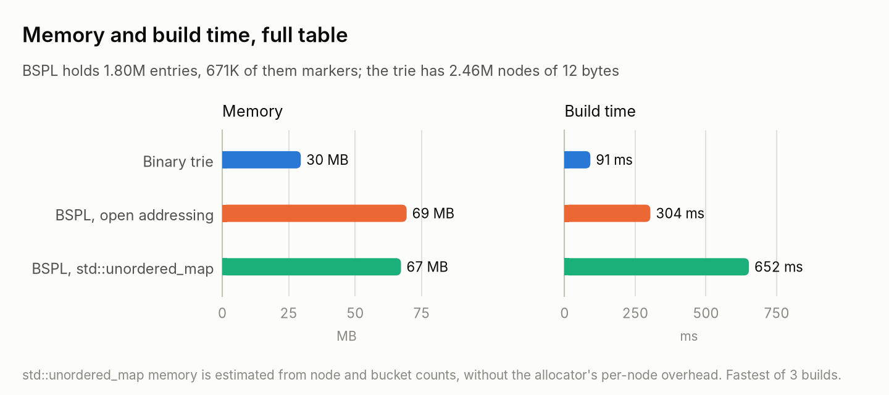

# ip-routing

IPv4 longest-prefix match in C++17, two ways: a binary trie, and binary search on prefix lengths (BSPL) with markers
(Waldvogel et al., SIGCOMM 1997). Both are checked against a linear scan and timed on a real BGP table: 1,125,729 IPv4
prefixes from RouteViews (1 October 2026).

<p align="center">
<picture>
  <source media="(prefers-color-scheme: dark)" srcset="docs/figures/lookup-dark.png">
  
</picture>
</p>

## Results at a glance

On the full RouteViews table, for addresses inside its prefixes:

| Measure | Binary trie | BSPL, open addressing | BSPL, `std::unordered_map` |
|---|---|---|---|
| Time per lookup, independent lookups | 363 ns | **139 ns** | 399 ns |
| Time per lookup, dependent lookups (latency) | 326 ns | **191 ns** | 518 ns |
| Memory reads per lookup, mean | 24.2 trie nodes | 4.9 hash probes | 4.9 hash probes |
| Memory | **29.6 MB** | 69.4 MB | 67.3 MB (estimate) |
| Build time | **91 ms** | 304 ms | 652 ms |

- All three agree with a linear scan on 1,000,225 addresses over 1,000 random tables built to have deeply nested
  prefixes.
- BSPL with open addressing is 2.6 times faster than the trie for independent lookups and 1.7 times faster for
  dependent ones: it reads 4 or 5 hash slots instead of about 24 trie nodes.
- The same search on `std::unordered_map` is slower than the trie. Each of its probes divides to find a bucket, reads
  the bucket array and then follows a pointer to a separately allocated node.
- The speed costs memory: BSPL needs 2.3 times the trie's, for 1.80 million entries (670,645 of them markers) in tables
  kept at most half full.

## How it works

### Binary trie

[`src/trie.h`](src/trie.h). One node per address bit. Nodes live in one `std::vector` and refer to their children by
32-bit index, so a node takes 12 bytes and the whole trie is a single allocation. A lookup walks the address from its
first bit and remembers the last route it passed, reading at most 33 nodes.

### Binary search on prefix lengths

[`src/bspl.h`](src/bspl.h). There is one hash table per prefix length, keyed by the prefix's first bits. A lookup
probes the middle length: a hit means a longer match may exist, so the search moves to the longer lengths; a miss
moves it to the shorter ones. Two additions make this correct:

1. **Markers.** A long prefix is reachable only if every shorter length on its search path has an entry that sends the
   search longer. The build walks each prefix's search path and adds these markers.
2. **A best match in every entry.** A marker says that something longer exists, not that it matches the address. So
   every entry stores the longest real prefix that covers it, computed once at build time, and a lookup returns the
   best match of the last entry it hit.

<p align="center">
<picture>
  <source media="(prefers-color-scheme: dark)" srcset="docs/figures/bspl-dark.png">
  
</picture>
</p>

A lookup takes at most ⌈log₂(L + 1)⌉ probes for L distinct lengths: 5 for the 25 lengths (/8 to /32) in the RouteViews
table. Adding one prefix can change the markers and best matches of many entries, so the tables are built once from
the full prefix list.

### Two hash tables

BSPL takes its per-length hash table as a template parameter ([`src/hash_table.h`](src/hash_table.h)):

- `ChainedTable` wraps `std::unordered_map`: separate chaining, one heap-allocated node per entry.
- `FlatTable` uses open addressing: 12-byte slots (key, route, best match) in one array with a power-of-two size,
  linear probing, Fibonacci hashing, and at most half of the slots in use. A probe usually reads one cache line.

## Benchmark

<p align="center">
<picture>
  <source media="(prefers-color-scheme: dark)" srcset="docs/figures/steps-dark.png">
  
</picture>
</p>

<p align="center">
<picture>
  <source media="(prefers-color-scheme: dark)" srcset="docs/figures/memory-dark.png">
  
</picture>
</p>

`make bench` runs [`bench/bench_lpm.cpp`](bench/bench_lpm.cpp):

- **Table:** the RouteViews prefix-to-AS snapshot of 2026-10-01 12:00 published by CAIDA, with the origin AS as the
  next hop: 1,125,729 prefixes, 64% of them /24s. Random subsets of 1,000 to 300,000 prefixes keep its mix of lengths.
- **Addresses:** 1 million per table, each inside a prefix of the table chosen uniformly at random, with random host
  bits. On the full table, also 1 million addresses uniform over the IPv4 space, of which 72.9% have a route.
- **Timing:** one pass looks up all 1 million addresses and is timed with `std::chrono::steady_clock`. The result is the
  median of 11 passes after a warm-up, with the passes of the three structures interleaved. In **independent** lookups
  the CPU can overlap consecutive lookups; in **dependent** lookups each address depends on the previous result, which
  measures the latency of a single lookup.
- **Machine:** one core (pinned with `taskset`) of an Intel Core i5-1035G1 laptop; g++ 13.3 with `-O2`.

Full table, nanoseconds per lookup:

| Addresses | Lookups | Binary trie | BSPL, open addressing | BSPL, `std::unordered_map` |
|---|---|---|---|---|
| inside the table's prefixes | independent | 363 | **139** | 399 |
| inside the table's prefixes | dependent | 326 | **191** | 518 |
| uniform over IPv4 | independent | 150 | **127** | 340 |
| uniform over IPv4 | dependent | 139 | **129** | 347 |

Uniform addresses are cheaper for the trie, which reads 15.5 nodes for them on average instead of 24.2: about a quarter
of them have no route, and their walk ends early. BSPL's probe count barely changes (4.6).

These are laptop timings. Between two runs on the full table, with addresses inside its prefixes, dependent lookups
changed by less than 3% and independent ones by up to 21%; the order of the three structures did not change. All
numbers, for every table size, are in [`results/`](results/).

## Correctness

`make test` runs three programs:

- [`tests/test_ipv4.cpp`](tests/test_ipv4.cpp): address and prefix parsing, including malformed input and host bits
  that must be cleared.
- [`tests/test_lpm.cpp`](tests/test_lpm.cpp): fixed cases (the sample table, an empty table, a default route, a /32
  host route, a chain of nested prefixes, a repeated prefix) and a differential test. It builds 1,000 random tables of
  up to 1,000 prefixes, most of them nested under or covering another, and looks up 1,000 addresses in each, including
  the first and last address of prefixes and the address just after. All three structures must return what a linear
  scan returns, and BSPL must stay within its probe bound: 0 mismatches on 1,000,225 addresses.
- [`tests/test_hash_table.cpp`](tests/test_hash_table.cpp): both hash tables on about 100,000 keys, including 0,
  2³² − 1 and a run of consecutive keys.

## Build and run

Needs a C++17 compiler and make. The benchmark also needs curl; the figures need Python 3 with matplotlib.

```sh
make                # builds into build/
make test
./build/iproute data/sample.csv 192.168.20.20 192.168.20.191 8.8.8.8
./build/iproute --bspl data/sample.csv 192.168.20.20
make bench          # downloads the RouteViews table (4 MB compressed) and writes results/
python3 scripts/plots.py
```

```text
$ ./build/iproute data/sample.csv 192.168.20.20 192.168.20.191 8.8.8.8
192.168.20.20 -> Router1 via 192.168.20.16/28
192.168.20.191 -> Router2 via 192.168.0.0/16
8.8.8.8 -> no route
$ ./build/iproute --bspl data/routeviews/routeviews-20261001-1200.csv 8.8.8.8 1.1.1.1
8.8.8.8 -> AS15169 via 8.8.8.0/24
1.1.1.1 -> AS13335 via 1.1.1.0/24
```

With no addresses on the command line, `iproute` reads one address per line from standard input. A routing table is a
CSV file with a header line, then one `prefix,next_hop` row per route, as in [`data/sample.csv`](data/sample.csv):

```text
IP_Prefix,Router
192.168.20.16/28,Router1
192.168.0.0/16,Router2
192.168.1.0/24,Router3
10.10.0.0/16,Router4
```

## Layout

```text
src/ipv4.{h,cpp}            addresses and prefixes as uint32_t: parse, mask, print
src/trie.{h,cpp}            binary trie
src/bspl.{h,cpp}            binary search on prefix lengths
src/hash_table.{h,cpp}      FlatTable (open addressing) and ChainedTable (std::unordered_map)
src/routing_table.{h,cpp}   CSV routing table loader
tools/iproute.cpp           command-line lookups
tests/                      unit and differential tests
bench/bench_lpm.cpp         benchmark
scripts/                    RouteViews download and README figures
results/                    benchmark output behind the numbers above
```

## References

- M. Waldvogel, G. Varghese, J. Turner and B. Plattner. *Scalable High Speed IP Routing Lookups.* ACM SIGCOMM 1997.
- Routeviews Prefix to AS mappings Dataset for IPv4 and IPv6,
  <https://www.caida.org/catalog/datasets/routeviews-prefix2as/>. It is downloaded by
  [`scripts/fetch_routeviews.sh`](scripts/fetch_routeviews.sh) and is not included in this repository.
